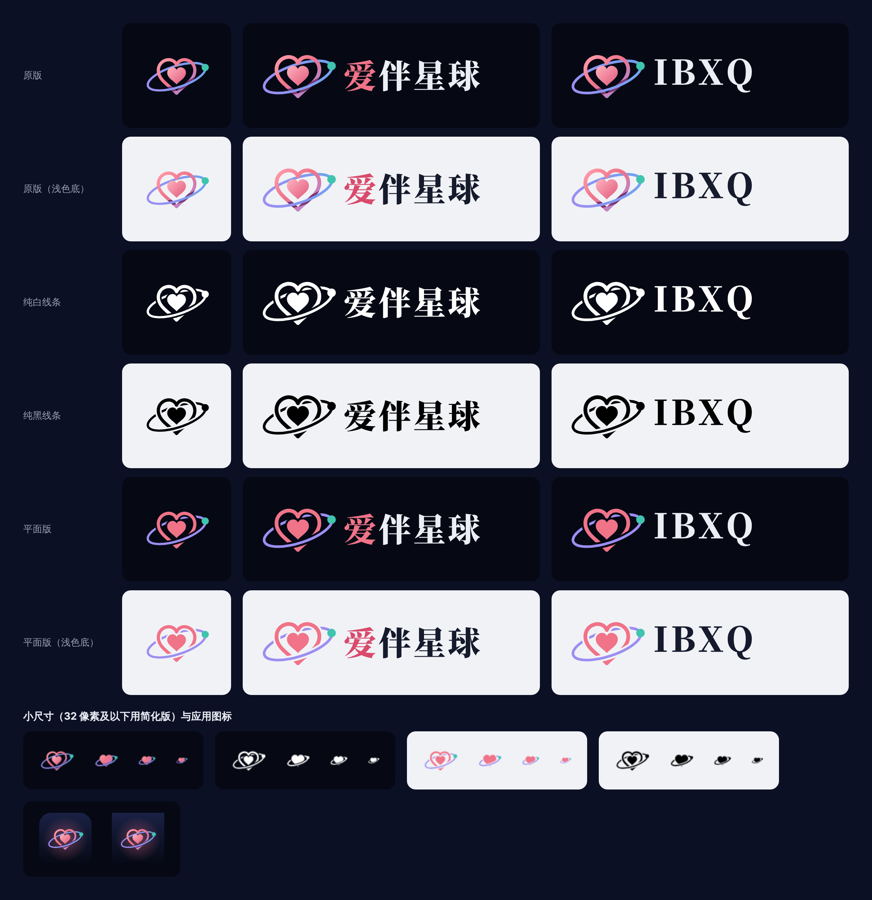

# 爱伴星球 IBXQ 标志



这个目录里的文件都由 `scripts/build-brand.py` 生成，不要手改。要调整标志，改脚本后重新运行：

```bash
pip install fonttools brotli pillow
```

```bash
python3 scripts/build-brand.py
```

脚本还需要 Node 和 Playwright（用 Chromium 把 SVG 渲染成 PNG）。它同时会更新网站根目录的 `favicon.svg`、`favicon.ico`、`favicon-32.png` 和 `apple-touch-icon.png`。

## 三种组合

| 组合 | 文件名前缀 | 用在哪 |
|---|---|---|
| 标志 | `ibxq-mark-` | 头像、图标、空间很小的地方 |
| 标志 + 爱伴星球 | `ibxq-logo-zh-` | 中文场合的页眉、文档、海报 |
| 标志 + IBXQ | `ibxq-logo-en-` | 英文场合，或需要和域名对应的地方 |

## 四种风格

| 风格 | 文件名里的词 | 说明 |
|---|---|---|
| 原版 | `original` | 带渐变，首选 |
| 纯白线条 | `white` | 单色白，放在深色底或照片上 |
| 纯黑线条 | `black` | 单色黑，放在浅色底上，也适合单色印刷 |
| 平面版 | `flat` | 纯色无渐变，适合刺绣、丝印、不支持渐变的软件 |

原版和平面版的「标志 + 文字」各有两份，区别只在文字颜色：`-on-dark` 是浅色字，放深色底；`-on-light` 是深色字，放浅色底。单独的标志不分深浅底。

文字已经转成轮廓，使用这些文件不需要安装字体。

## 目录

```
brand/
  svg/         矢量源文件，能用 SVG 的地方优先用它
  png/
    mark/<风格>/              ibxq-mark-<风格>-<边长>.png
    logo-zh/<风格和底色>/      ibxq-logo-zh-<风格和底色>-h<高度>.png
    logo-en/<风格和底色>/      ibxq-logo-en-<风格和底色>-h<高度>.png
  app-icon/    带深色底的方形图标和 favicon.ico
  preview.png  全部版本一览
```

所有 PNG 都是透明底（`app-icon/` 除外）。

## 尺寸

**标志**（正方形，单位像素）：16、24、32、48、64、96、128、256、512、1024。

16、24、32 这三个尺寸用的是简化版（一颗实心爱心加轨道，对应 `svg/ibxq-mark-small-*.svg`），因为完整版缩到这么小会糊。自己从 SVG 导出 32 像素以下的图时，也请用 `small` 版。

**标志 + 文字**（按高度）：32、64、128、256、512，宽度按比例。

**应用图标**（`app-icon/`）：

| 文件 | 用途 |
|---|---|
| `ibxq-app-icon-1024.png` | App Store、应用商店提交 |
| `ibxq-app-icon-512.png`、`-192.png` | 安卓、PWA 桌面图标 |
| `ibxq-app-icon-180.png` | iOS 主屏幕（网站的 `apple-touch-icon.png` 就是它） |
| `ibxq-app-icon-rounded-*.png` | 自带圆角，用于桌面软件、文档、社交头像 |
| `favicon.ico` | 含 16、32、48 三个尺寸，用于 Windows 和旧浏览器 |

方形图标四角没有圆角，由系统自己裁切；标志留在中间约 70% 的范围内，不会被裁到。

## 在网页里引用

网站部署后，这些文件可以直接用地址引用，例如：

```html

```

## 颜色

| 用途 | 色值 |
|---|---|
| 爱心 | `#F07388` |
| 轨道 | `#9C8EF2`（渐变到 `#6FA2F0`） |
| 星球 | `#3FC4AF` |
| 深色底 | `#060914` |
| 浅色底上的文字 | `#151A2C` |
| 深色底上的文字 | `#ECEEF6` |
